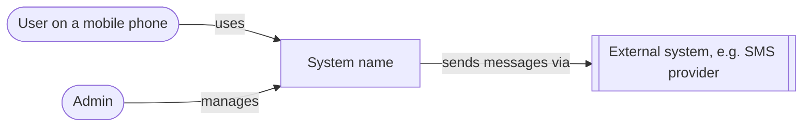
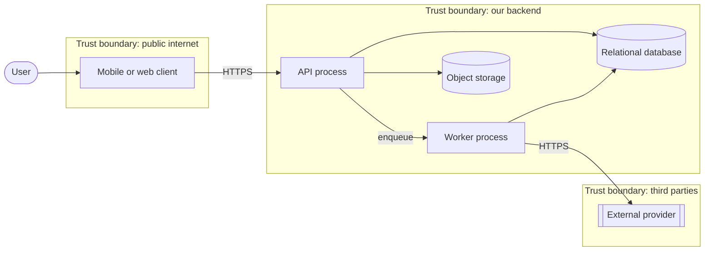

# C4 diagrams: <!-- system name -->

<!-- Template for docs/c4.md (architect skill, ARCH-22). Context and container
     levels only. Plain Mermaid flowcharts with labelled trust boundaries
     (subgraphs); Mermaid's C4 syntax is not used because it was not verified.
     A change that adds or removes a container, store, external system or trust
     boundary edits this file in the same change. -->

## Context

## Container

<!-- Label every trust boundary; the threat list in the brief has one table per boundary (ARCH-12). -->
